<p align="center">
  
</p>

<h1 align="center">EasyMold</h1>

<p align="center">
  <b>Molds for 3D printing, made in Blender: direct molds for silicone parts and mother molds for silicone.</b>
</p>

<p align="center">
  <a href="LICENSE"></a>
  
  <a href="https://github.com/M1STERS/EasyMold/releases/latest"></a>
  <a href="https://github.com/sponsors/M1STERS"></a>
</p>

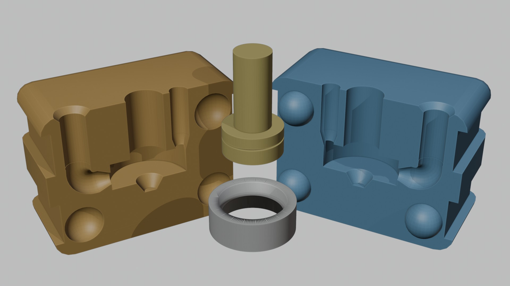

EasyMold is a Blender add-on that turns a mesh into a mold you can print. Select the object, choose a mold type, press
**Generate Mold**, and export the pieces for your slicer. It handles the fiddly parts for you: split planes,
registration keys, pour holes with funnels, air vents, clamping, cores for hollow parts, and pieces too big for your
print bed.

## What it does

EasyMold makes two kinds of molds:

- **Direct molds** (the cast part is the silicone). The printed block is the mold itself. Pour silicone in it to cast
  the object, for example a heater-block sock for a 3D printer hot end.
- **Mother molds for silicone** (the cast part is a silicone mold). The printed part holds liquid silicone around your
  master to make a silicone mold. You then use that silicone mold for wax, resin, plaster, soap…

## Features

### Direct molds with cores

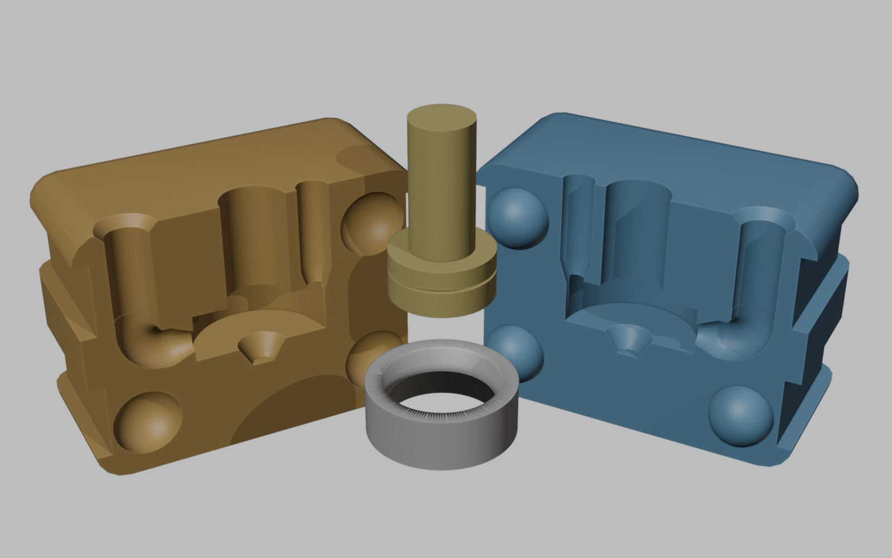

- The block is split into 2 or 4 parts, with registration keys that have a printing tolerance.
- For hollow parts, a printable **core** forms the inside, and its prints lock it in the block. **Auto Core** finds
  it for you, or you can pick your own object.
- **Clamping**: screws with nut traps, clips or elastic-band grooves.

### Pour channel and vents that work

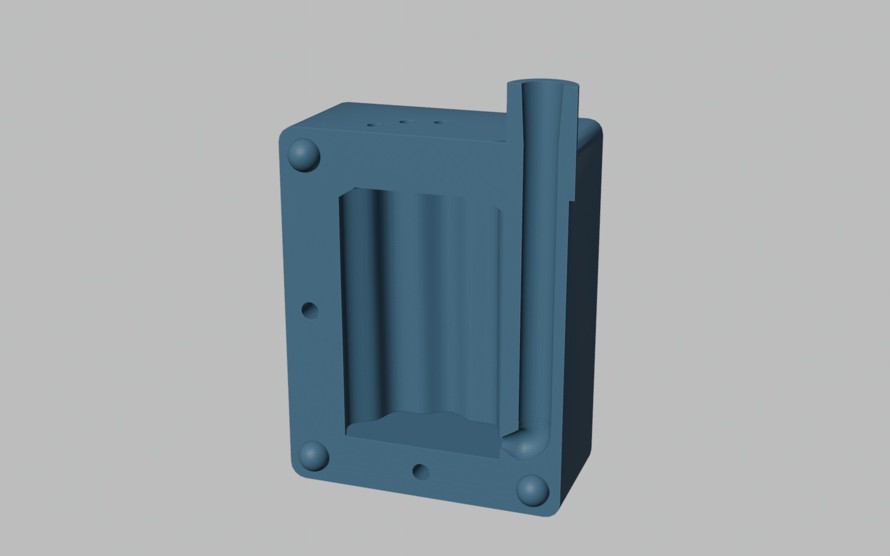

- **Pour Entry: Parting Line, Bottom** fills the part from below so the air leaves from the top. The channel has a
  round elbow.
- **Entry Tip** and **Vent Tip** narrow the hole where it touches the part, so the sprue is easy to trim.
- **Vent Path: Away from Part** leans a vent away from a thin wall instead of running down beside it. Vents go where
  air would otherwise be trapped.
- **Sprue Funnel**, or a **Straight Hole** with a chamfer.

### Silicone mold: Box

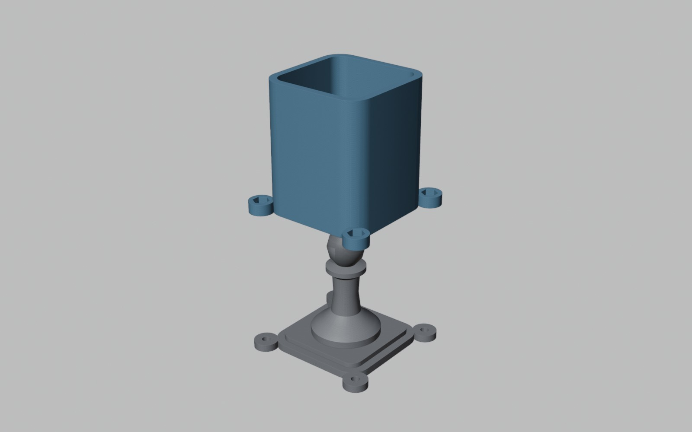

A printable box and base. The master stands on the base (it can be printed with it) and the walls fit over a lip.
The Material panel tells you how much silicone to mix.

### Silicone mold: Shell

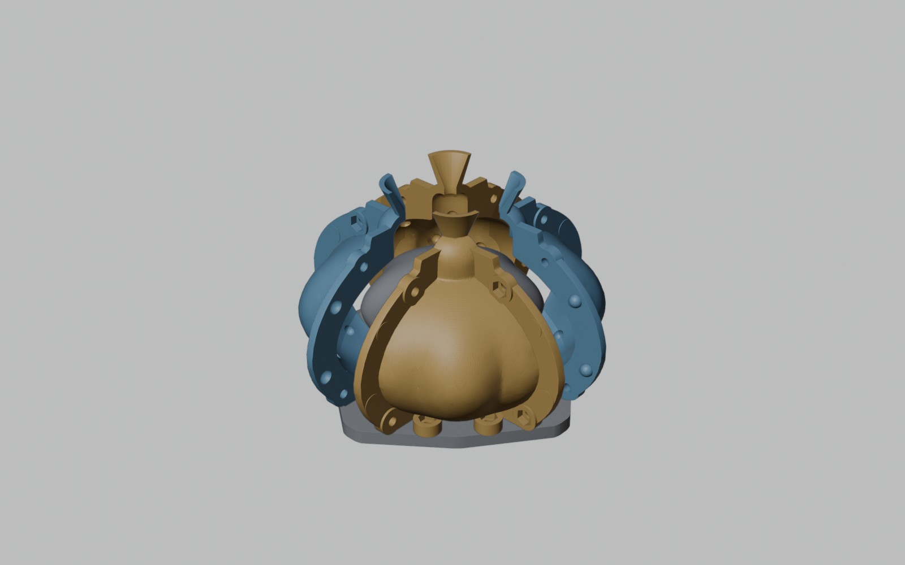

A shell that follows the master's shape, so a thin, even layer of silicone is enough. It can be split in 2 or 4 parts,
with flanges, keys, a pour funnel and **Silicone Anchors** that hold the silicone in place.

### Silicone mold: 2-Part

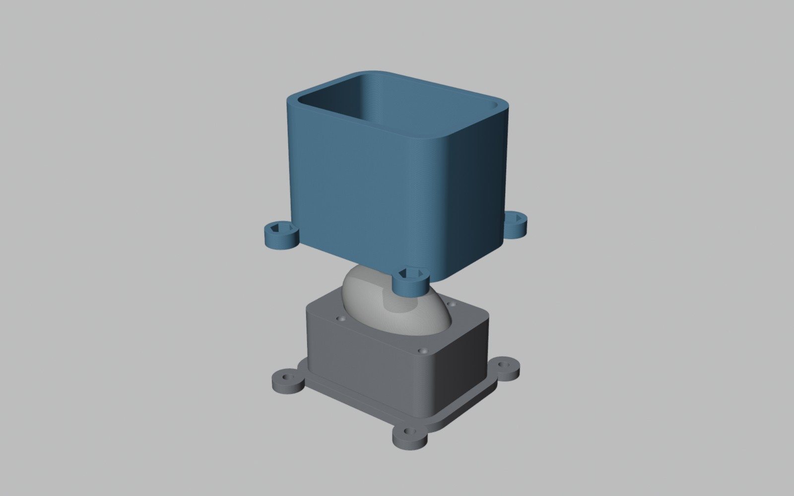

For masters with no flat side, such as figures and balls. Pour one half against the printed parting board, flip the
mold, remove the board and pour the other half. The parting line can be set by hand or found automatically.

### Several objects in one mold

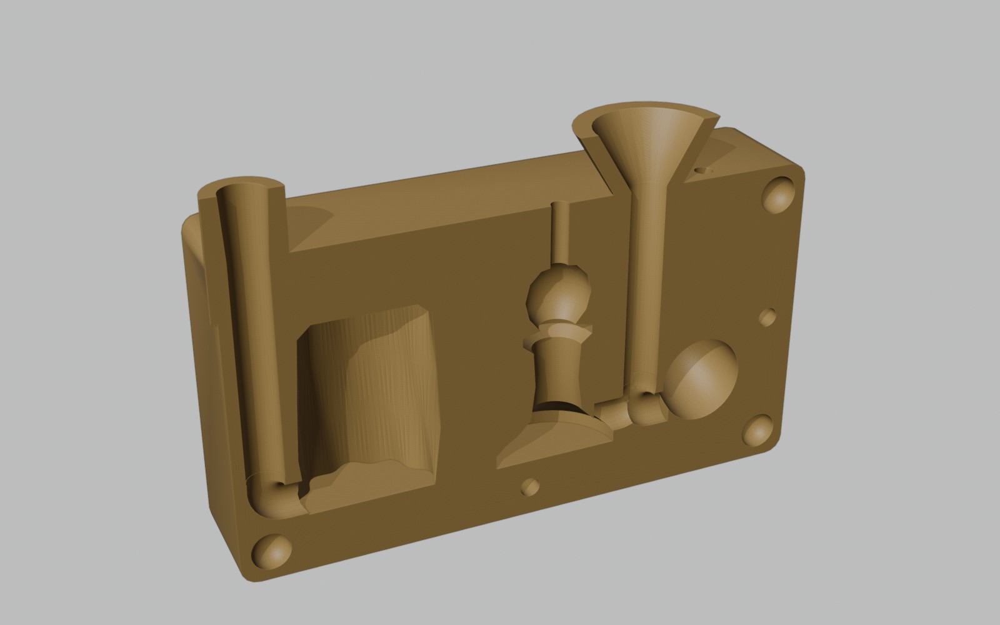

Select several objects and they are arranged in a row or a grid. All of them share one mold and one pour system.

### Curved parting surface

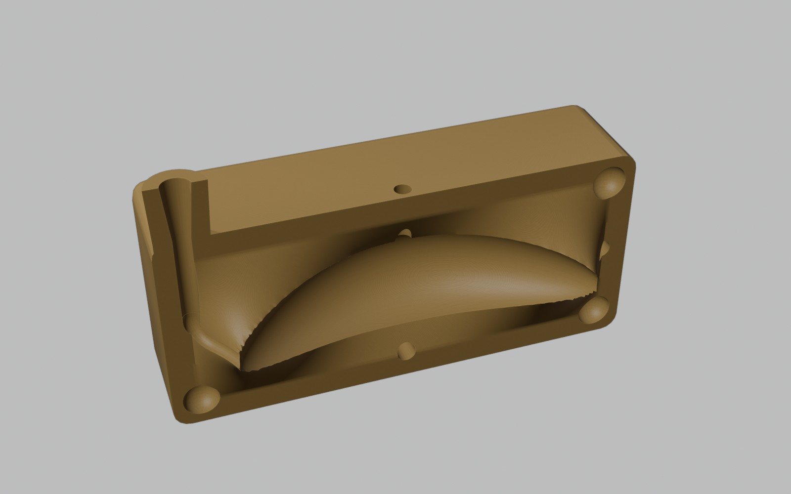

**Curved Parting** splits the mold along a surface that follows the part's widest outline, not a flat plane. This
helps with bent or tilted parts. In the layout, you can edit that surface like any mesh.

### Fits your print bed

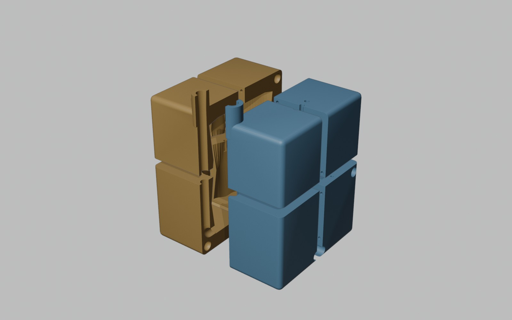

Set your bed size. Pieces that are too big are flagged. **Split to Fit** cuts them and adds holes for 1.75 mm filament
pins to glue them back in line. **Export for Printing** writes STL files or one 3MF plate, with each piece already on
its best flat face.

### Live preview and an editable layout

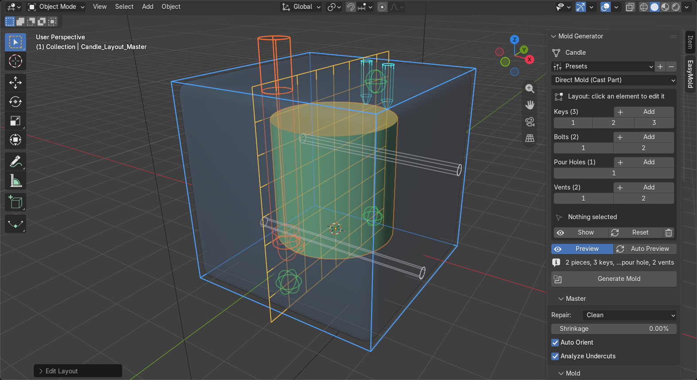

- **Preview** draws the mold over the viewport as you change the settings, without adding anything to the scene.
- **Auto Preview** builds a quick low-resolution version.
- **Edit Layout** turns every key, bolt, pour hole and vent into a marker you can add, move, resize or delete. The
  markers show their real shape and stay snapped where they work, on the split plane or on the part.

<p align="center">
  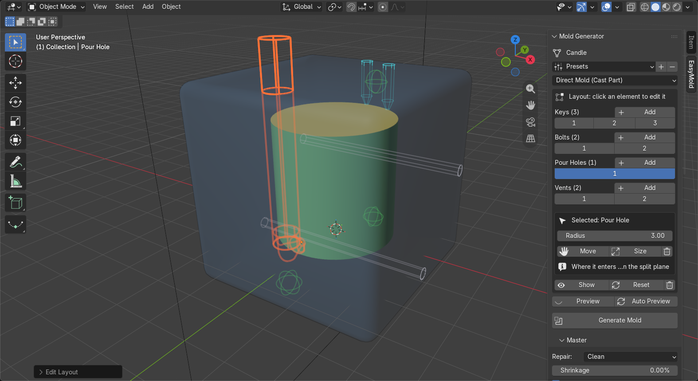
  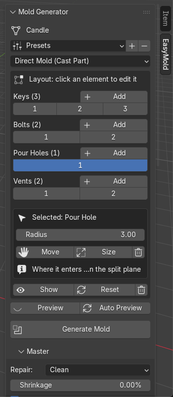
</p>

### And more

- **Repair** (Clean or Rebuild) for broken meshes. **Block Through-Holes** adds thin walls that close holes that
  would lock the silicone. **Analyze Undercuts** colors the faces that won't release.
- **Auto Orient** turns the object for the best split. **Shrinkage** compensation is a percentage.
- A **material calculator** gives silicone volume, weight, the A + B mix and cost, plus the weight of the cast part.
- **Presets** for common materials (wax candles, tin silicone, high-temperature silicone, resin, plaster, soap). You can
  also save your own.

## Install

Requires **Blender 5.2** or newer.

- **From Blender** (once the extension is approved): *Edit → Preferences → Get Extensions*, search for **EasyMold**,
  and click *Install*.
- **From a release**: download `easymold-1.0.0.zip` from the
  [latest release](https://github.com/M1STERS/EasyMold/releases/latest). In Blender, go to *Edit → Preferences →
  Get Extensions*, open the ⌄ menu (top right), choose *Install from Disk…* and pick the zip.

EasyMold lives in the 3D Viewport sidebar: press **N**, then open the **EasyMold** tab.

## Quick start

1. Select your object. Use millimeters: 1 Blender unit = 1 mm.
2. In the **EasyMold** tab, choose a **Mold Type**, or start from a **Preset**.
3. Set the **Parts** and the **Split Axis**, and check **Pouring** (pour hole, vents, entry).
4. Optional: turn on **Preview** to check it, or use **Edit Layout** to move keys, vents and the pour hole by hand.
5. Press **Generate Mold**. Your object is never changed; the mold goes to its own collection.
6. Open **Export**, pick STL or 3MF and a folder, and press **Export for Printing**.

## Mold types

| Mold type | Use it for | Printed pieces |
|---|---|---|
| Direct Mold (Cast Part) | Casting the object itself in silicone (socks, gaskets, grips) | 1, 2 or 4 block parts, plus an optional core |
| Silicone Mold: Box | A block silicone mold around a master with a flat base (candles, soaps) | Walls and base |
| Silicone Mold: Shell | A thin silicone mold that saves silicone on big masters | 1, 2 or 4 shell parts and a base |
| Silicone Mold: 2-Part | Masters with no flat side (figures, balls) | Frame, parting board, and the master with its sprue |

## Tips

- **Resolution** sets how fine the offsets are. Smaller is more precise but slower. Use Preview while you adjust, then
  generate.
- Meshes from scans or old STL files are often not closed. **Repair: Clean** fixes most of them, and **Rebuild**
  fixes the rest.
- Keep **Key Tolerance** at about 0.2 mm for FDM printers. Tune it to your printer if the parts are too tight or too
  loose.
- Set your **Print Bed** before you generate, so oversized pieces are caught early.

## Support the project

EasyMold is free and open source. If it saves you time or silicone, you can support its development on
**[GitHub Sponsors](https://github.com/sponsors/M1STERS)**. Thank you!

## Development

The add-on is plain Python. The tests run Blender headless:

```bash
BLENDER="/path/to/blender" bash tests/run_all.sh
```

Every result should read `FAILURES: none` with 0 tracebacks and no non-manifold pieces. `docs/media/` holds the
scripts that make the images in this README.

## Roadmap

- Translations: the UI is in English for now. Translation files that anyone can edit are planned.

Ideas and bug reports are welcome in [Issues](https://github.com/M1STERS/EasyMold/issues).

## License

EasyMold is released under the [GNU General Public License v3.0 or later](LICENSE).
© 2026 Eddy Moncada Garcia.
